<div align="center">



# ⚡ Awesome Command Line Search Tools 🔍

<p align="center">
  <a href="https://github.com/ishandutta2007/Awesome-Awesome-Awesome"></a>
  <a href="https://discord.gg/jc4xtF58Ve"></a>
  <a href="https://github.com/ishandutta2007/Awesome-Awesome-Awesome"></a>
  <a href="https://github.com/ishandutta2007/Awesome-Command-Line-Search-Tools/stargazers"></a>
  <a href="https://github.com/ishandutta2007/Awesome-Command-Line-Search-Tools/network/members"></a>
  <a href="https://github.com/ishandutta2007/Awesome-Command-Line-Search-Tools/blob/main/LICENSE"></a>
  <a href="https://github.com/ishandutta2007"></a>
</p>

<p align="center">
  <strong>🚀 A curated directory of high-performance command line search tools, recursive regex engines, interactive terminal fuzzy finders, AST code matchers, and enterprise code search SaaS platforms.</strong>
</p>

<p align="center">
  <em>Last updated: October 2026 🗓️</em>
</p>

</div>

---

## 📑 Table of Contents

- [📊 Sector Overview & Market Dynamics](#-sector-overview--market-dynamics)
- [☁️ SaaS & Hosted Enterprise Code Search Platforms](#️-saas--hosted-enterprise-code-search-platforms)
- [💻 Open-Source GitHub Projects](#-open-source-github-projects)
- [🛠️ The Modern CLI Search Stack](#️-the-modern-cli-search-stack)
- [⭐ Star History](#--star-history)
- [💖 Support & Community](#-support--community)
- [🤝 How to Contribute](#-how-to-contribute)
- [⚖️ Disclaimer](#️-disclaimer)

---

## 📊 Sector Overview & Market Dynamics

The global enterprise code search and developer discovery market operates as a high-growth vertical within the broader **$5.3B–$7.8B enterprise search market** (growing at an estimated **8.5%–11.3% CAGR** 📈). 

The sector is **highly fragmented**: rather than a single winner-take-all monopoly, code search is partitioned across lightweight terminal-native developer CLI utilities, integrated development environment (IDE) search mechanisms, code hosting platform search engines (GitHub, GitLab), and specialized enterprise cross-repository intelligence platforms (Sourcegraph). Furthermore, the emergence of AI code navigation, Retrieval-Augmented Generation (RAG), and AST-based syntactic search continues to decentralize developer workflows across multiple specialized utilities. 🌐

---

## ☁️ SaaS & Hosted Enterprise Code Search Platforms

The following SaaS platforms provide hosted, web-based, or enterprise-scale cross-repository code search, navigation, and code intelligence.

| SaaS Product 🏷️ | Organization / Company Scale (Valuation / Revenue) 🏢 | Starting Tier Pricing 💳 | Free Plan Limits / Free Trial Period 🎁 | Key Features & Search Capabilities 🔍 |
| :--- | :--- | :--- | :--- | :--- |
| **[GitHub Search & Code Intelligence](https://github.com)** | **$4.01T Market Cap** (Microsoft parent) / **$2.0B+ ARR** (GitHub subsidiary) | **$4.00 per user/month** (GitHub Team plan; Enterprise Cloud at $21/user/month) | **Free forever**: Unlimited public/private repos, 2,000 GitHub Actions CI/CD min/month, 500 MB Packages storage, 120 Codespaces core-hours/month | Native exact regex, symbol navigation, path filters (`path:`, `repo:`), code indexing across global and private repositories. |
| **[GitLab Advanced Search](https://about.gitlab.com)** | **$8.8B–$9.3B Market Cap** (NASDAQ: GTLB) / **$1.05B TTM Revenue** | **$29.00 per user/month** (GitLab Premium, billed annually) | **60-day free trial** of GitLab Ultimate (unlimited projects, includes full Advanced Search evaluation); Free tier lacks cross-project global search | Elasticsearch/OpenSearch-powered global indexing across code, commits, issues, merge requests, and project wikis. |
| **[Sourcegraph](https://sourcegraph.com)** | **$2.6B Valuation** (Series D) / **~$35M–$50M ARR** | **$19.00 per user/month** (Enterprise Starter tier, up to 50 devs & 100 repos; Full Enterprise from $16,000/year minimum contract) | **30-day free trial** (unlimited self-hosted or cloud evaluation for teams via sales request); Free public search index on Sourcegraph.com for open source | Universal multi-repository code search, regex, AST/structural matching (Comby), symbol definition jumps, and `src-cli` terminal integration. |
| **[JetBrains Search & IDE Ecosystem](https://www.jetbrains.com)** | **$700M+ Annual Revenue** / **Bootstrapped (~$1B+ private valuation)** | **$24.90 per user/month** ($249/year IntelliJ IDEA commercial; $979/year All Products Pack) | **30-day free trial** for commercial IDE editions (no credit card required, 45-day extended trial for verified teams); IntelliJ IDEA Community / basic edition free forever | Semantic symbol indexing, "Search Everywhere" (`Double Shift`), structural search and replace (SSR), and local regex caching. |

---

## 💻 Open-Source GitHub Projects

The following open-source command line search tools, fuzzy finders, and text utilities are ranked by GitHub stargazer count (descending) 🌟.

| Project 📦 | GitHub_Stars ⭐ | License 📜 | Description & Highlights 💡 |
| :--- | :---: | :---: | :--- |
| **[fzf](https://github.com/junegunn/fzf)** | [](https://github.com/junegunn/fzf/stargazers) | MIT | **Command-line fuzzy finder**. The industry standard for interactive filtering. Blazing-fast interactive finder with async streaming, customizable layout, preview windows, and default shell keybindings (`Ctrl+T`, `Ctrl+R`, `Alt+C`). ⚡ |
| **[ripgrep (rg)](https://github.com/BurntSushi/ripgrep)** | [](https://github.com/BurntSushi/ripgrep/stargazers) | MIT / Unlicense | **Line-oriented recursive search tool**. The gold standard modern grep replacement written in Rust. Uses SIMD byte scanning, parallelism, respects `.gitignore` rules, searches compressed files (`-z`), and supports PCRE2 (`-P`). 🦀 |
| **[bat](https://github.com/sharkdp/bat)** | [](https://github.com/sharkdp/bat/stargazers) | Apache-2.0 / MIT | **Cat clone with syntax highlighting and Git integration**. Widely paired with `fzf` and `ripgrep` for live syntax-highlighted code previews during interactive search. 🦇 |
| **[fd](https://github.com/sharkdp/fd)** | [](https://github.com/sharkdp/fd/stargazers) | Apache-2.0 / MIT | **Fast, user-friendly alternative to `find`**. Features intuitive syntax, parallel directory traversal, `.gitignore` awareness, colorized output, and command execution (`-x`). 🔎 |
| **[The Silver Searcher (ag)](https://github.com/ggreer/the_silver_searcher)** | [](https://github.com/ggreer/the_silver_searcher/stargazers) | Apache-2.0 | **Code-searching tool similar to ack, but faster**. Written in C, paved the way for modern ignore-aware grep replacements with 3–10× speedups over ack. 🥈 |
| **[difftastic](https://github.com/Wilfred/difftastic)** | [](https://github.com/Wilfred/difftastic/stargazers) | MIT | **Structural diff tool that understands syntax**. Uses tree-sitter parsers to compare code by syntax tree structure rather than line-by-line diffing, filtering out whitespace noise. 🌲 |
| **[ast-grep](https://github.com/ast-grep/ast-grep)** | [](https://github.com/ast-grep/ast-grep/stargazers) | MIT | **Fast CLI tool for code structural search, linting, and rewriting**. Written in Rust, matches code syntax trees rather than plain regex strings, preventing false positives in comments and strings. 🌳 |
| **[peco](https://github.com/peco/peco)** | [](https://github.com/peco/peco/stargazers) | MIT | **Simplistic interactive filtering tool**. Go-based terminal interactive filtering utility designed for Unix pipelines and log filtering. 🎯 |
| **[sd](https://github.com/chmln/sd)** | [](https://github.com/chmln/sd/stargazers) | MIT | **Intuitive find & replace CLI (sed alternative)**. Written in Rust, uses standard JavaScript/Python regex syntax with verbatim string replacement and blazing-fast execution. 🔄 |
| **[skim (sk)](https://github.com/skim-rs/skim)** | [](https://github.com/skim-rs/skim/stargazers) | MIT | **Fuzzy Finder written in Rust**. A Rust-native alternative to fzf with interactive query support, dynamic multi-selection, and full terminal embedding. 🎿 |
| **[ugrep](https://github.com/Genivia/ugrep)** | [](https://github.com/Genivia/ugrep/stargazers) | BSD-3-Clause | **Ultra fast grep with interactive query TUI**. Highly feature-dense grep alternative supporting fuzzy search, boolean queries (AND/OR/NOT), hex dumps, and nested compressed archives (zip, 7z, tar, gz). 🧰 |
| **[platinum searcher (pt)](https://github.com/monochromegane/the_platinum_searcher)** | [](https://github.com/monochromegane/the_platinum_searcher/stargazers) | MIT | **Multi-platform code search tool**. Written in Go, searches code patterns with cross-encoding support and zero runtime dependencies. 🏎️ |
| **[sift](https://github.com/svent/sift)** | [](https://github.com/svent/sift/stargazers) | GPL-3.0 | **Fast and powerful alternative to grep**. Go-based CLI search tool supporting multiline regex search, conditions, and custom file type classifications. 🌪️ |
| **[codespelunker (cs)](https://github.com/boyter/cs)** | [](https://github.com/boyter/cs/stargazers) | MIT / Dual | **Relevance-ranked code search tool**. CLI and TUI code search utility that understands code structure and ranks results by relevance with zero indexing overhead; features MCP and HTTP server modes. 🧭 |
| **[ack](https://github.com/beyondgrep/ack3)** | [](https://github.com/beyondgrep/ack3/stargazers) | Artistic-2.0 | **Grep-like search tool optimized for source code**. The pioneering programmer-focused search utility written in Perl; introduced first-class file-type filtering before `.gitignore` standardization. 🐪 |
| **[ruplacer](https://github.com/your-tools/ruplacer)** | [](https://github.com/your-tools/ruplacer/stargazers) | BSD-3-Clause | **Find and replace text in source files**. Rust CLI that recursively searches directories, prints colored diffs of prospective replacements, and asks for user confirmation. 🔁 |
| **[Sourcegraph CLI (src)](https://github.com/sourcegraph/src-cli)** | [](https://github.com/sourcegraph/src-cli/stargazers) | Apache-2.0 | **Command-line interface to Sourcegraph instances**. Execute multi-repository searches, batch changes, and code intelligence queries directly from the terminal. 🌐 |
| **[Glimpse](https://github.com/PixelKnightDev/Glimpse)** | [](https://github.com/PixelKnightDev/Glimpse/stargazers) | MIT | **Interactive code search TUI with instant editor integration**. Real-time search with split-pane layout, instant file preview, vim navigation keys, and direct jump-to-editor support. 🖥️ |
| **[seekly](https://pypi.org/project/seekly/)** | *(PyPI Package)* | MIT | **Natural language semantic code search**. Python CLI utilizing code embeddings to locate functions and files based on natural language queries rather than exact string patterns. 🧠 |
| **[GNU grep](https://www.gnu.org/software/grep/)** | *(Coreutils)* | GPL-3.0 | **The foundational Unix text search utility**. POSIX-compliant, universal, and built into every Unix system; ideal for portable pipeline scripts (`tail -f log \| grep pattern`). 🐧 |

---

## 🛠️ The Modern CLI Search Stack

Modern terminal productivity relies on composing fast, single-purpose Unix tools together:

```bash
# 🚀 The canonical interactive code search pipeline:
# 1. fd locates files quickly respecting .gitignore
# 2. ripgrep searches file contents with SIMD acceleration
# 3. fzf provides an interactive fuzzy selection UI
# 4. bat renders a syntax-highlighted preview of matched lines

rg --color=always --line-number --no-heading --smart-case "" |
  fzf --ansi \
      --color "hl:-1:underline,hl+:-1:underline:reverse" \
      --delimiter : \
      --preview 'bat --color=always {1} --highlight-line {2}' \
      --preview-window 'up,60%,border-bottom,+{2}+3/3,~3'
```

---

## 🤝 How to Contribute

1. Fork this repository 🍴
2. Add or update entries in `README.md` maintaining alphabetical order or star-sorted order as appropriate.
3. Keep descriptions factual, link directly to official repositories, and ensure license details are accurate.
4. Submit a Pull Request with a clear description of the addition! ✨

---

##  Star History
[](https://star-history.dera.page/#ishandutta2007/Awesome-Command-Line-Search-Tools&type=date&legend=top-left)

---

## 💖 Support & Community

Thank you so much for visiting this project! If you find this curated collection of command line search tools useful, please consider supporting the project:

- ⭐ **Star this repository** to help others discover it!
- 🍴 **Fork and share** it with fellow developers, sysadmins, and terminal enthusiasts.
- 💬 **Join our community on [Discord](https://discord.gg/jc4xtF58Ve)** to discuss developer tooling, shell productivity, and CLI workflows.
- ☕ **Support the maintainer**: If you'd like to fuel further maintenance and curation, you can buy me a coffee through the **[GitHub Sponsors Dashboard](https://github.com/sponsors/ishandutta2007)**!

Your support and contributions keep this repository vibrant, up-to-date, and valuable for everyone. 🙏

---

## ⚖️ Disclaimer

- This list is community-maintained and curated for educational and productivity reference.
- Stars_Counts and pricing figures reflect publicly available data as of October 2026 and may change over time.
- Always verify licensing and security compliance before indexing proprietary source code in hosted cloud engines.
